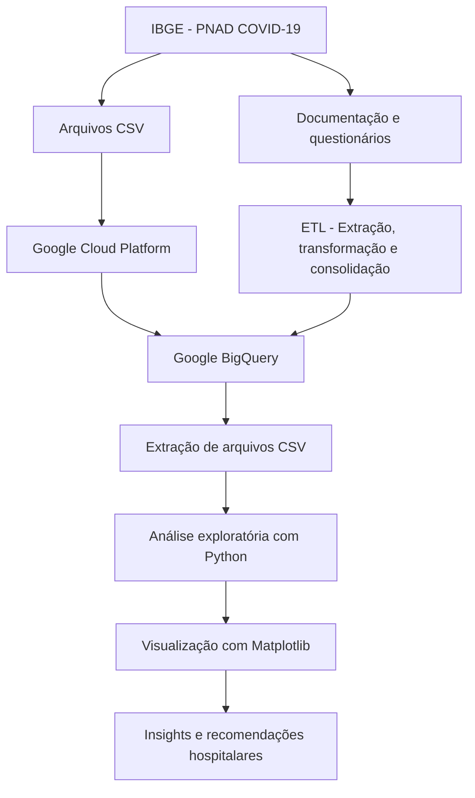

# 🦠 COVID-19 Data Analytics | Planejamento Estratégico Hospitalar


## 📌 Sobre o projeto

Este projeto foi desenvolvido como parte do Tech Challenge 3 da pós-graduação da FIAP, com foco na aplicação de Data Analytics à saúde pública e ao planejamento estratégico hospitalar.

Utilizando dados da pesquisa PNAD COVID-19, disponibilizada pelo Instituto Brasileiro de Geografia e Estatística (IBGE), foram analisadas características clínicas, demográficas, socioeconômicas e ocupacionais da população brasileira entre julho e setembro de 2020.

O projeto contempla desde a extração, transformação e armazenamento dos dados em ambiente de nuvem até a análise exploratória, visualização e elaboração de recomendações estratégicas orientadas por dados.

## 🏥 Problema de negócio

O desafio consiste em atuar como uma equipe de especialistas em Data Analytics contratada por um grande hospital para compreender o comportamento da população brasileira durante a pandemia de COVID-19.

A questão central do projeto é:

> Como utilizar os dados da pandemia de COVID-19 para auxiliar hospitais na preparação e na tomada de decisões diante de novos surtos da doença? 

## 🎯 Objetivos

- Identificar características clínicas e demográficas dos casos positivos.
- Compreender a demanda por atendimento, internações e respiradores artificiais.
- Investigar a presença de sintomas e comorbidades.
- Avaliar a vulnerabilidade socioeconômica da população.
- Compreender os impactos da pandemia no mercado de trabalho.
- Elaborar recomendações para o planejamento de recursos hospitalares.

## 📚 Fonte de dados

| Característica | Descrição |
|---|---|
| Fonte | Instituto Brasileiro de Geografia e Estatística (IBGE) |
| Pesquisa | PNAD COVID-19 |
| Período | Julho, agosto e setembro de 2020 |
| Abrangência | Brasil |
| Perguntas de negócio | 20 |
| Dimensões analisadas | 4 |
| Armazenamento | Google BigQuery |

Fonte oficial: [PNAD COVID-19 — IBGE](https://covid19.ibge.gov.br/)

## 🏗️ Arquitetura da solução

A arquitetura foi desenvolvida utilizando serviços de armazenamento e processamento em nuvem, integrados a ferramentas de análise e visualização de dados.



### Etapas do processamento

1. Obtenção dos microdados e documentação do IBGE.
2. Armazenamento dos dados em ambiente de nuvem.
3. Extração, transformação e consolidação no BigQuery.
4. Desenvolvimento de consultas SQL.
5. Extração dos resultados em arquivos CSV.
6. Análise exploratória utilizando Python.
7. Construção de gráficos e indicadores.
8. Elaboração de recomendações estratégicas.

## 🛠️ Tecnologias utilizadas

| Tecnologia | Aplicação |
|---|---|
| Google Cloud Platform | Infraestrutura em nuvem |
| Google BigQuery | Armazenamento, transformação e consulta de dados |
| SQL | Extração, filtragem e agregação de informações |
| Python | Processamento e análise exploratória |
| Pandas | Manipulação e transformação de dados |
| NumPy | Operações numéricas |
| PySpark | Processamento de dados |
| Matplotlib | Visualização de dados |
| Jupyter Notebook | Desenvolvimento e documentação das análises |
| Google Colab | Ambiente de execução |

## 🔎 Perguntas de negócio

Foram selecionadas 20 perguntas estratégicas, organizadas em quatro dimensões de análise.

### 1. Demografia

1. Qual foi o perfil etário dos entrevistados que testaram positivo?
2. Quantos casos positivos vieram de áreas urbanas e rurais?
3. Qual foi a distribuição dos casos positivos entre homens e mulheres?
4. Qual foi a proporção de casos positivos por cor ou raça?
5. Qual foi a proporção de casos positivos por região do Brasil?

**Finalidade:** compreender a distribuição dos casos e identificar grupos populacionais e regiões relevantes para o planejamento de ações preventivas.

### 2. Saúde

6. Quais foram os sintomas mais recorrentes em pacientes positivos para COVID-19?
7. Quais foram os sintomas mais recorrentes em pacientes que necessitaram de respiradores artificiais?
8. Quantos pacientes positivos necessitaram de respiradores artificiais?
9. Quantas pessoas com comorbidades testaram positivo para COVID-19?
10. Quantas pessoas com comorbidades precisaram de respiradores artificiais?
11. Quais foram as comorbidades mais frequentes entre os pacientes positivos?
12. Quantas pessoas buscaram hospitais e quantas foram internadas?

**Finalidade:** fornecer informações relevantes para o dimensionamento de leitos, equipamentos, medicamentos e equipes hospitalares.

### 3. Aspectos socioeconômicos

13. Famílias que receberam auxílio emergencial ou Bolsa Família tinham acesso a itens de proteção contra a COVID-19?
14. Qual foi a participação dos rendimentos de programas sociais na renda domiciliar durante a pandemia?
15. Qual foi a relação entre o recebimento do auxílio emergencial e a condição do domicílio?

**Finalidade:** compreender a vulnerabilidade econômica da população e as possíveis desigualdades no acesso à proteção e à saúde.

### 4. Mercado de trabalho

16. A população manteve-se trabalhando, estava afastada temporariamente ou não estava inserida no mercado de trabalho?
17. Quais foram os principais motivos de afastamento do trabalho durante a pandemia?
18. Qual foi a proporção da população que conseguiu exercer suas atividades em home office?
19. Houve impacto na remuneração, comparando o rendimento habitual com o efetivamente recebido?
20. Qual foi a proporção de pessoas que estavam em busca de trabalho e quais foram os motivos para não procurar?

**Finalidade:** compreender os impactos econômicos e ocupacionais da pandemia e suas possíveis implicações para a saúde e o bem-estar da população.

## 📊 Principais resultados

### Perfil demográfico

- 40,3% dos casos positivos estavam na faixa etária de 18 a 39 anos.
- 37,1% estavam na faixa de 40 a 59 anos.
- 86,8% dos casos positivos estavam concentrados em áreas urbanas.
- 55,4% dos casos positivos correspondiam a mulheres.
- Pessoas pardas e brancas concentraram a maior parte dos registros positivos.

#### Distribuição regional dos casos positivos

| Região | Participação nos casos positivos |
|---|---:|
| Nordeste | 34,0% |
| Norte | 22,1% |
| Sudeste | 21,0% |
| Centro-Oeste | 13,5% |
| Sul | 9,4% |

### Indicadores clínicos e hospitalares

| Indicador | Resultado apresentado |
|---|---:|
| Pacientes positivos que buscaram atendimento de saúde | 71% |
| Procura por hospitais no recorte de atendimento | 32% |
| Procura por postos de saúde ou UBS | 40% |
| Internações no recorte analisado | 18% |
| Utilização de respiradores no recorte correspondente | 38% |
| Presença de comorbidades no grupo positivo analisado | 7% |
| Presença de comorbidades entre usuários de respiradores | 21% |

#### Sintomas mais frequentes

| Posição | Pacientes positivos | Pacientes que utilizaram respiradores |
|---|---|---|
| 1º | Dor de cabeça | Dispneia |
| 2º | Febre | Febre |
| 3º | Tosse | Tosse |

Hipertensão e diabetes foram as comorbidades mais frequentes identificadas nas análises.

Os resultados destacam a importância do monitoramento dos sintomas respiratórios, das comorbidades e da capacidade assistencial.

### Aspectos socioeconômicos

- 88,7% das famílias analisadas apresentaram acesso a itens de proteção, como máscaras e álcool em gel.
- 44,9% declararam recebimento de auxílio emergencial.
- 4,4% declararam recebimento do Bolsa Família.
- 2,8% declararam recebimento de benefícios assistenciais.
- 66,5% das famílias residiam em imóveis próprios quitados.

As análises exploraram a importância dos programas de transferência de renda e das condições habitacionais no contexto da vulnerabilidade socioeconômica.

### Impactos no mercado de trabalho

- 47% dos registros indicaram que a pessoa não trabalhou no período de referência.
- Aproximadamente 72% a 73% dos afastamentos foram relacionados à quarentena, ao isolamento ou às férias coletivas.
- No recorte de respostas aplicáveis sobre trabalho remoto, 71% indicaram home office.
- 6% dos registros indicaram redução de renda.
- Apenas 0,5% indicaram aumento de renda.
- 5% declararam ter procurado trabalho.
- Cerca de 94 mil registros apontaram a pandemia como motivo para não procurar emprego.

## 💡 Recomendações estratégicas

Com base nas análises realizadas, foram propostas ações para melhorar a capacidade de resposta hospitalar diante de novos surtos.

### Triagem e fluxo de atendimento

- Implantar triagem respiratória rápida.
- Separar fluxos de pacientes respiratórios e não respiratórios.
- Disponibilizar teleorientação para casos leves.

### Capacidade assistencial

- Elaborar planos de expansão de leitos de enfermaria e UTI.
- Monitorar estoques de oxigênio e respiradores.
- Treinar e redistribuir equipes hospitalares.
- Estabelecer critérios para ampliação da capacidade de atendimento.

### Acompanhamento de grupos de risco

- Desenvolver fluxos de atendimento para grupos vulneráveis.
- Monitorar pacientes com comorbidades.
- Adotar protocolos de reconhecimento precoce de deterioração clínica.

### Controle de infecções

- Garantir disponibilidade de equipamentos de proteção individual.
- Reforçar protocolos de higiene e prevenção.
- Organizar fluxos de isolamento de pacientes.

### Diagnóstico e monitoramento

- Agilizar processos de testagem.
- Propor dashboards para acompanhamento de indicadores hospitalares.
- Monitorar ocupação de leitos, respiradores e consumo de oxigênio.

### Integração da rede de saúde

- Fortalecer a comunicação entre hospitais, UBS, UPA e SAMU.
- Estabelecer critérios de encaminhamento de pacientes.
- Planejar leitos de retaguarda para períodos de maior demanda.

### Cuidado domiciliar e comunicação

- Utilizar telemedicina para acompanhamento de pacientes.
- Desenvolver estratégias de acompanhamento pós-alta.
- Promover campanhas educativas sobre prevenção e sinais de alerta.
- Considerar vulnerabilidades sociais e econômicas no planejamento assistencial.

## 📂 Estrutura do repositório

    techChallenge_Covid/
    │
    ├── arquivos_csv/
    ├── querys/
    ├── pos_3_jupyter.ipynb
    ├── Tech Challenge 3 - COVID.pdf
    └── README.md

## 📑 Documentação do projeto

A apresentação completa contém a arquitetura da solução, as perguntas de negócio, os gráficos, as análises e as recomendações estratégicas.

- [Apresentação completa — Tech Challenge COVID-19](./Tech%20Challenge%203%20-%20COVID.pdf)
- [Notebook de análise exploratória](./pos_3_jupyter.ipynb)

## 🚀 Como acessar o projeto

Clone o repositório:

```bash
git clone https://github.com/CarolyneSoares/techChallenge_Covid.git
```

Abra o notebook `pos_3_jupyter.ipynb` utilizando o Jupyter Notebook ou o Google Colab.

A reprodução das análises pode exigir ajustes nos caminhos dos arquivos, configuração das dependências e acesso às bases de dados utilizadas no ambiente de desenvolvimento.

## ⚠️ Limitações da análise

- Os resultados correspondem ao período de julho a setembro de 2020.
- As informações são provenientes de uma pesquisa amostral.
- Os indicadores possuem diferentes recortes e populações de referência.
- As análises são predominantemente descritivas e não estabelecem relações de causalidade.
- Proporções observadas na amostra não devem ser interpretadas automaticamente como taxas de incidência ou risco para toda a população brasileira.
- Alguns indicadores socioeconômicos apresentados são descritivos e não demonstram integralmente as relações propostas nas perguntas de negócio.
- A utilização dos resultados em decisões clínicas exige validação complementar.

## 🧠 Competências aplicadas

- Data Analytics
- Exploratory Data Analysis (EDA)
- SQL
- Google Cloud Platform
- Google BigQuery
- ETL — Extract, Transform and Load
- Data Cleaning
- Data Transformation
- Data Visualization
- Business Problem Solving
- Data Storytelling
- Data-Driven Decision Making
- Healthcare Analytics

## ✅ Conclusão

O projeto demonstra como a análise de dados pode contribuir para o planejamento estratégico de instituições de saúde.

A integração entre processamento de dados em nuvem, análise exploratória e compreensão do contexto populacional permitiu identificar indicadores relevantes para a organização de recursos hospitalares e a elaboração de estratégias preventivas.

Os aprendizados reforçam a importância do planejamento contínuo, da integração entre equipes de saúde e da tomada de decisões orientada por dados.

## 👩‍💻 Autoras

- [Carolyne Rafaella Soares Costa](https://github.com/CarolyneSoares)
- Natalia Alexandra Leite Trippo
- [Natane Cezario Barbosa](https://github.com/NataneCezario)
- Tainara Covas Nogueira

## 🎓 Contexto acadêmico

Projeto desenvolvido como parte do Tech Challenge 3 da pós-graduação da FIAP, com aplicação de técnicas de análise de dados ao contexto da saúde pública.
